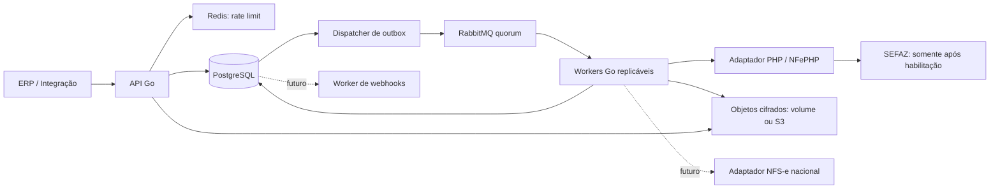

# Arquitetura

HTTP é stateless quanto ao fluxo fiscal: a fonte de verdade está no PostgreSQL,
não na memória do processo. Tokens não conferem acesso global: primeiro derivar
`tenant_id`, depois autorizar `company_id` e a operação.

O cliente HTTP `internal/engine.FiscalProvider` separa Go de NFePHP. O adaptador
recebe dados internos transformados a partir do DTO público, jamais URLs SOAP ou
métodos arbitrários fornecidos pelo cliente. Biblioteca, XSD, assinatura e PDF são
reutilizados; autorização/armazenamento/orquestração pertencem ao AllSpark.

Papéis do mesmo binário: api, worker, dispatcher, migrate, tenant-create, key-revoke.
Cada container recebe apenas os secrets necessários ao papel. Dispatcher não recebe
chave mestra nem certificado. Broker recebe somente IDs de trabalho.

Estado futuro: balanceador/WAF/TLS, APIs replicadas, workers por tipo/operação,
PostgreSQL HA, RabbitMQ de três nós, object storage privado compartilhado e KMS.
O Compose atual é desenvolvimento de nó único; quatro workers não equivalem a HA.
