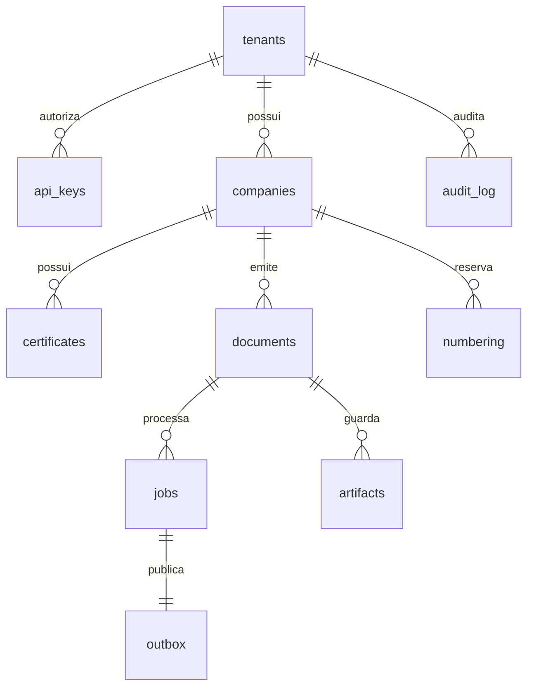

# PostgreSQL e consistência

Esquema executável: `migrations/001_initial.sql`. Migração idempotente de bootstrap;
antes de evoluir em produção adotar migrações versionadas imutáveis e expand/contract.

FKs compostas `(tenant_id,company_id)` e `(tenant_id,document_id)` protegem vínculos.
Índices tenant/empresa/data, estado de jobs/lease, pending outbox, certificado ativo,
idempotência e numeração. Números são reservados com INSERT/ON CONFLICT/RETURNING;
nunca SELECT MAX+1. Restrição de unicidade fiscal vale para `issue`.
Prévia `generate` usa número sintético sem alterar sequência.

Transação de aceitação inclui documento, job, outbox, número e auditoria. Lock
consultivo transacional serializa a mesma chave de idempotência antes da reserva.
Hash é do JSON canonicalizado. Campos fiscais monetários são strings para não
perder precisão; transformação interna usa aritmética racional.

Mensagens duplicadas são normais; claim de job só muda queued→processing uma vez.
`lease_token` é o token de posse: finalização e checkpoint verificam sua identidade.
Consulta de reconciliação trava documento e não admite múltiplos jobs ativos.

Modelo futuro adiciona users/roles/sessions, company_settings, document_events,
webhook_endpoints/events/deliveries, batches/imports, fiscal_requests/responses e
controle de idempotência por operação. Não criar tabelas sem fluxo funcional apenas
para simular cobertura. Planejar partições/arquivamento por data com medidas reais.
