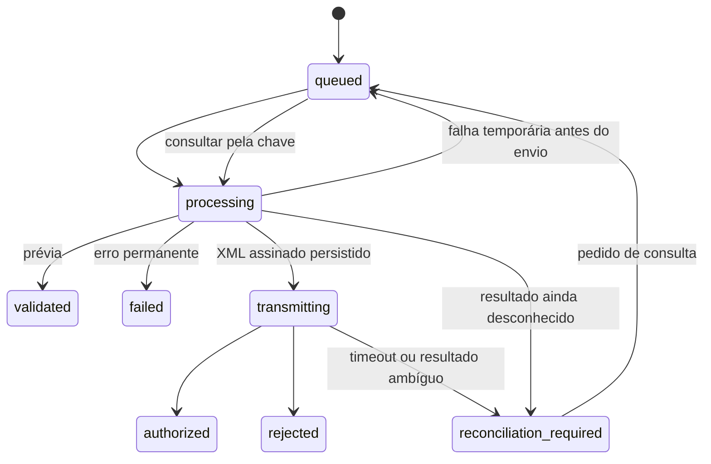

# Fluxo fiscal

1. Autenticar o tenant pela credencial; exigir scope e validar empresa.
2. Validar JSON de negócio e limites; valores decimais são strings.
3. Abrir transação: proteger chave de idempotência, verificar replay/hash, reservar
   número somente para `issue`, gravar documento, job e outbox, gravar auditoria.
4. Retornar 202 com ID. Confirmação da API significa persistência, não autorização fiscal.
5. Dispatcher publica ID com confirmação do broker. Worker faz claim atômico e assume lease.
6. Worker carrega empresa e certificado, decifra em memória e chama o adaptador.
7. NFePHP monta XML, assina e valida XSD. `generate` termina em `validated`, sem envio.
8. Para `issue`, guardar XML assinado/chave antes de marcar `transmitting` e enviar.
9. Persistir protocolo e XML processado quando autorizado; gerar DANFE e guardar arquivos.
10. Disponibilizar consulta e download. Publicação de webhooks ainda será implementada.

`validated` significa geração local com XSD, não validação de enquadramento tributário
nem autorização da SEFAZ. A prévia usa número sintético 1 e não atualiza `numbering`.
Não pode ser usada como documento autorizado ou posteriormente retransmitida manualmente.
A emissão real gera seu próprio documento e reserva número em transação.

Timeout depois do envio não é rejeição e não permite retry cego. Expiração de lease
na fase `transmitting` exige consulta pela chave. Retorno ambíguo de lote, duplicidade
ou protocolo incompleto conserva `reconciliation_required`.

Falha no PDF não desfaz autorização fiscal. Recuperação dedicada de PDF será uma
fila separada; atualmente a resposta pode conter `PDF_UNAVAILABLE` e XML autorizado.
Cancelamento, carta de correção e inutilização serão eventos separados; não apagar
XML autorizado nem editar o histórico para simular um evento confirmado.
